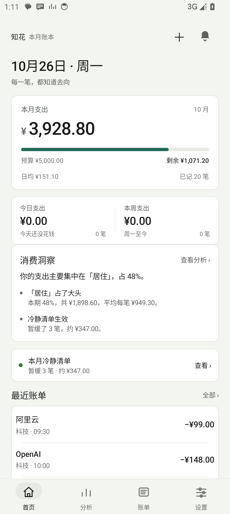
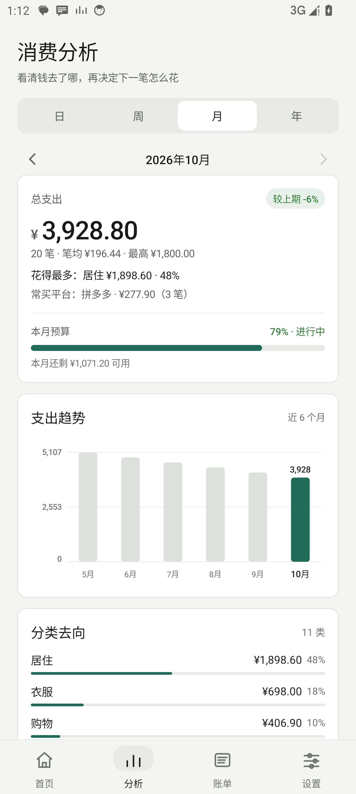
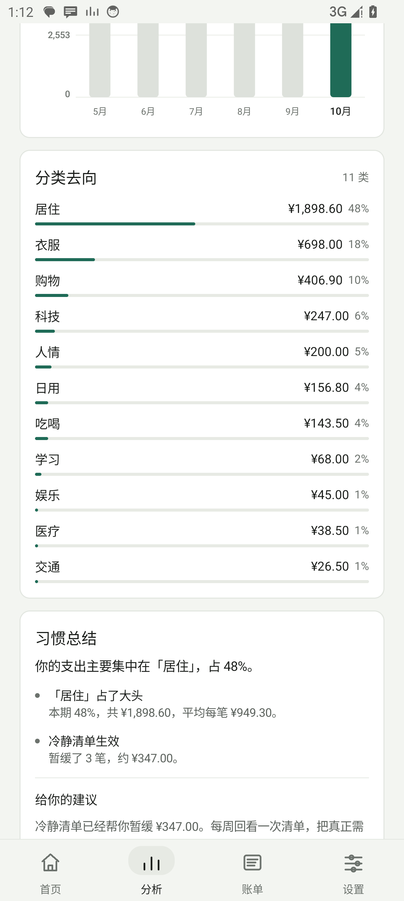
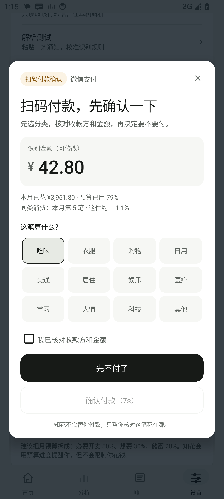
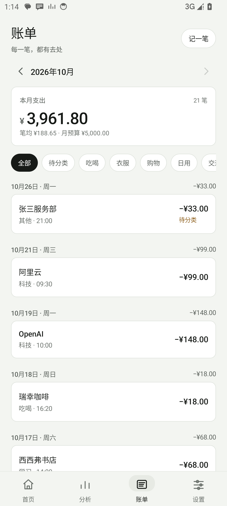
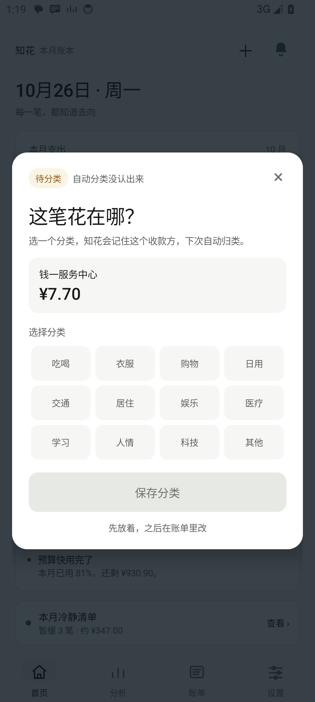
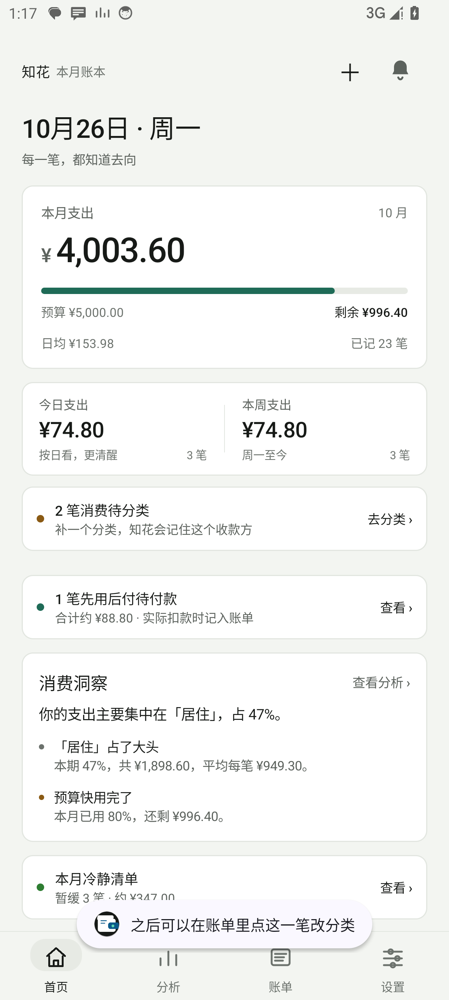
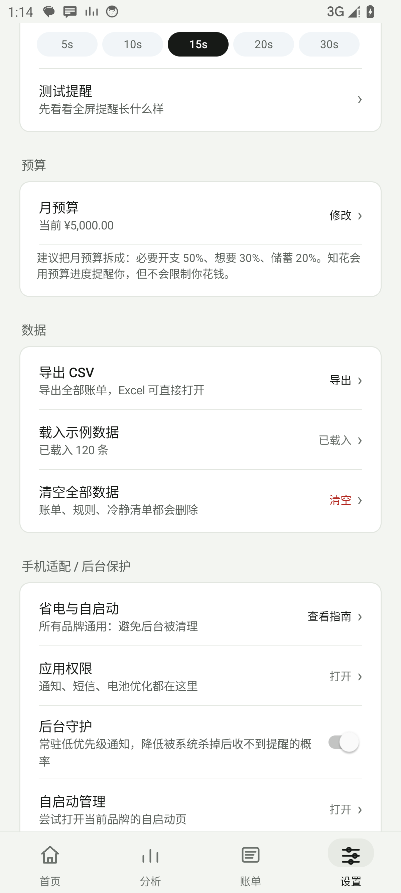
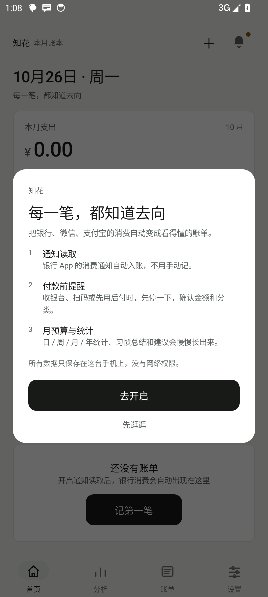
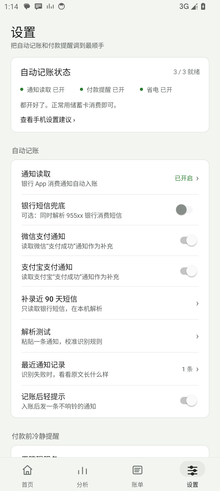

# 知花 · 银行消费记账

> 小米 14 / HyperOS · 多银行 · 多品牌 Android · 本地优先 · 不联网 · 非建设银行官方应用

知花是一款为“储蓄卡消费 + 移动支付”场景做的个人记账 App。它读取银行 App 的消费通知（可选银行短信、微信/支付宝支付通知），自动落账、分类，并按日 / 周 / 月 / 年给出统计、消费习惯总结和建议；在拼多多、抖音、淘宝、京东进入收银台，或在微信/支付宝主动扫码付款时，弹出付款前确认，让你先选分类、核对金额，再决定要不要付。先用后付会先记成“待付款”，实际扣款时再转成正式账单。

| 首页 | 分析 |
|---|---|
|  |  |

| 分类去向 | 扫码付款确认 |
|---|---|
|  |  |

| 账单 | 待分类手动选择 |
|---|---|
|  |  |

| 先用后付 | 提醒软件与扫码开关 |
|---|---|
|  |  |

| 首次设置 | 设置 |
|---|---|
|  |  |

### 外观方向

界面按 **Achromatic ledger（无彩账本）** 重做：鼠尾草纸色背景、墨色文字、白色纸卡，只有“主数据”用苔绿；没有渐变、没有彩色图标底、没有 emoji、没有阴影堆叠。金额统一右对齐、数字等宽，分类用单色横条而不是彩虹环形图。

- 主屏是“账本封面 + 本月余量条”，金额是唯一主角；今日/本周是同一张纸上的分栏，不再拆成两张卡片。
- 分类分析改成单色排序横条；不再用 12 色环形图。
- 账单行不再放彩色 emoji 圆底，改为“商户 + 分类/时间 + 右对齐金额”的账本行。
- 设置行去掉 emoji 图标；状态用绿/琥珀小圆点表达。
- 付款确认、待分类、首次引导都统一到纸卡、墨色按钮和 10–20dp 圆角。
- 当前是浅色账本主题；系统深色不会自动反色。

## 1. 已实现的功能

### 自动记账

- 监听建行、工商、农业、中国、交通、招商、邮储、浦发、中信、民生、兴业、光大、华夏、广发、平安等银行 App 的消费通知，自动提取：金额、商户、消费平台、卡尾号、时间、余额、通知原文。
- 也兼容未在名单里的银行：只要通知里同时出现银行名、尾号和储蓄卡/借记卡等关键词，就会尝试解析。
- 支持常见格式，例如：
  - `您尾号1234的储蓄卡于10月18日17:09在拼多多消费人民币35.50元，余额1234.56元。`
  - `您尾号1234的储蓄卡10月18日12:30消费支出人民币128.00元。`
  - `您尾号1234的储蓄卡10月18日17:09向支付宝-拼多多支付35.50元。`
  - `……向财付通-美团支付35.50元。`
  - `……交易商户：肯德基`
- 识别“支付宝-拼多多”“财付通-美团”“微信支付-滴滴”等渠道 + 实际收款方，不再一律归到“其他”。
- 可选读取 **微信 / 支付宝的“支付成功”通知**，作为银行卡通知的补充；同一笔会按金额 + 时间去重。
- 退款、入账、营销、理财、贷款类通知会被过滤。
- 90 秒内相同金额 / 时间的重复通知自动去重；通知、短信、微信/支付宝支付通知同时到达不会记两笔。
- 可选开启 **银行短信兜底**，并可 **补录近 90 天** 银行短信（955xx 等发件人）。
- 支持手动记一笔、编辑金额 / 商户 / 分类 / 时间 / 备注、删除。
- 入账后会发一条不响铃的轻提示；可关闭。

### 分类

内置 12 个分类：**吃喝、衣服、购物、日用、交通、居住、娱乐、医疗、学习、人情、科技、其他**。

- 按商户名、平台名、收款方和通知关键词自动分类，例如拼多多 → 购物、美团外卖 → 吃喝、优衣库 → 衣服、OpenAI/阿里云/数码 → 科技。
- 微信“收款方：沙县小吃”、支付宝“商户：滴滴出行”等也能从支付通知里提取出来再分类。
- 你手动改过一次分类后，会记住这个商户，下次自动使用你的分类。
- 账单里点任意一笔即可修改。
- 自动分类失败的支出会进入 **待分类**：首页卡片、账单筛选、分类浮层、待分类通知四个入口，直接选分类即可。

### 统计与分析

- **日 / 周 / 月 / 年** 四个视图，周从周一开始。
- 总支出、笔数、笔均、单笔最高、环比上期。
- 近 7 天 / 8 周 / 6 个月 / 5 年趋势柱状图。
- 分类占比环形图、金额、百分比、分类进度条。
- 常买平台（按笔数）、最常去的商户。
- 月预算进度、剩余可用金额。
- **习惯总结**：主要花在哪、是否周末偏高、是否深夜消费、是否小额高频。
- **给你的建议**：根据分类、平台、预算、深夜、小额、周末等规则生成可执行的建议，不联网、不调用大模型。

### 付款前冲动消费确认

- 在 **拼多多、抖音、淘宝、京东** 的收银台页面，识别到“确认支付 / 立即支付 / 提交订单 / 收银台”等按钮时，弹出全屏提醒。
- 显示：识别金额（可修改）、本月已花、预算已用比例、同类消费笔数、这笔占本月支出比例。
- 选择分类，勾选“我已想清楚，不是冲动消费”，等待冷静倒计时（默认 15 秒，可调 5–30 秒），才能点“仍然支付”。
- “再想想，先不买”会记录到冷静清单；“仍然支付”也会记录，等建行通知到达后自动关联这笔支出。
- 付款后建行通知到达，会自动把这次确认和账单关联，标记“确认后购买”或“冷静后仍购买”。
- 冷静清单可查看暂缓笔数、金额和明细。

> 说明：知花不能代替你付款，也不能拦截银行扣款。它做的是“付款前强制暂停 + 确认”，最终是否支付仍由你决定。

### 主动扫码付款确认

- 在 **微信 / 支付宝** 扫商家码进入“向商家付款 / 确认付款”页面时，也会弹出全屏确认。
- 默认会从页面里的“收款方：xxx”“商户：xxx”推断分类；能推断就预选，推断不了就默认“其他”，并**要求你手动点一个分类**，否则不能确认付款。
- 扫码提醒默认倒计时 8 秒（上限 8 秒），仍然需要勾选“我已核对收款方和金额”。
- 可单独关闭“扫码付款提醒”“微信扫码付款”“支付宝扫码付款”，不影响拼多多/抖音购物提醒。

### 待分类：自动分类失败时直接选

- 银行/微信/支付宝通知入账后，如果商户无法匹配分类，知花会立即弹出 **“这笔花在哪？”** 分类浮层。
- 浮层里显示收款方、金额，12 个分类直接点；保存后会自动记住这个收款方。
- 如果先关掉浮层，这笔会标记为 **待分类**：
  - 首页出现“N 笔消费待分类”卡片；
  - 账单顶部有“待分类”筛选；
  - 通知栏会有一条“已记账 · 待分类”的通知；
  - 点任意入口都能打开账单，选分类保存。
- 微信/支付宝支付通知也会走同一套分类逻辑。

### 先用后付：下单先记，付款再入账

- 在拼多多、抖音、淘宝、京东、美团等页面识别到“先用后付 / 确认收货后付款 / 0元下单”时，自动记一笔 **待付款**，不计入当月支出。
- 手动记一笔时，也可以勾选 **“先用后付（暂不计入支出）”**。
- 首页出现“N 笔先用后付待付款 · 合计约 ¥X”卡片，点开可以：
  - 查看每笔的收款方、金额、分类、下单时间；
  - **标记已付款**：按最终金额转成正式账单；
  - 删除记录。
- 实际扣款时，银行/微信/支付宝通知到达后，会按金额/收款方自动匹配待付款并转成账单，不会重复计一笔。
- 如果通知没来，可以手动“标记已付款”。

### 自动识别 / 手动添加提醒软件

- 设置页会列出已安装的消费类 App（购物、商城、外卖、买菜、支付、出行等），默认打开拼多多、抖音、淘宝、京东、微信、支付宝、美团、饿了么等常用项。
- 点 **“添加其他应用”** 可以从手机已安装应用里手动勾选任意 App。
- 只有勾选的 App 才会被无障碍服务读取收银台/扫码/先用后付页面。
- 新增 **扫码付款提醒** 总开关；微信/支付宝扫码是否提醒由应用列表控制。

### 多品牌 Android 与后台守护

- 不再绑定小米：HyperOS、华为/荣耀、OPPO/一加/realme、vivo/iQOO、三星等都可以使用。
- 设置 → **手机适配 / 后台保护** 提供对应品牌的自启动/省电路径和通用权限引导。
- 新增 **后台守护**：一条低优先级常驻通知 + 进程守护，降低无障碍/通知监听被系统回收后收不到提醒的概率；可在设置中关闭。
- 开机后自动尝试恢复后台守护（需要“自启动”权限）。
- 说明：任何 App 都不能保证在所有厂商的省电策略下永不被杀；后台守护只是降低概率，仍建议按指南设置“无限制/允许后台活动/锁定最近任务”。

### 本地与隐私

- **没有申请 `INTERNET` 权限**，从系统层面就无法联网上传。
- 账单、通知原文、分类规则、冷静清单、先用后付记录全部保存在本机 SQLite。
- 可选权限：通知使用权、无障碍服务、短信读取、通知权限、忽略电池优化、查询已安装应用（用于自动识别消费软件）。
- 支持导出 CSV（系统文件选择器，由你决定保存位置）。
- 清空数据会删除账单、规则、冷静清单、先用后付和通知记录；卸载 App 也会删除。

## 2. 安装

最新 APK（GitHub Releases）：

<https://github.com/GJCZX123/zhihua/releases/latest>

本地构建输出：

```
dist/ZhiHua-1.2.0.apk
```

要求：Android 8.0（API 26）及以上；已在 Android 14（API 34）模拟器上按小米 14 的 1200×2670 / 460dpi 分辨率验证。

安装方式二选一：

1. 把 APK 发到手机，文件管理器点击安装，允许“安装未知应用”。
2. 或电脑连接手机后：

```bash
adb install -r dist/ZhiHua-1.2.0.apk
```

首次打开会请求通知权限，并显示三步引导。

## 3. 小米 14 / HyperOS 首次设置

这一步很关键，否则通知可能收不到、付款提醒可能不弹。

### 3.1 开启通知读取

App 内：**设置 → 通知读取 → 去开启**。

或手动：

> 设置 → 应用设置 → 应用管理 → 知花 → 权限 → 通知使用权 → 打开

### 3.2 开启无障碍（付款前提醒）

App 内：**设置 → 无障碍服务 → 去开启**。

或手动：

> 设置 → 更多设置 → 无障碍 → 已下载的应用 → 知花 → 打开

如果提示 **“受限制的设置”**：

> 设置 → 应用设置 → 应用管理 → 知花 → 右上角 ⋮ → 允许受限制的设置，再回来打开无障碍。

### 3.3 省电、自启动、后台

App 内：**设置 → 自启动与省电 → 查看指南**。

建议：

1. 应用管理 → 知花 → **省电策略 → 无限制**。
2. 应用管理 → 知花 → **自启动 → 打开**。
3. 最近任务卡片下拉，把知花 **锁定**。
4. 如果系统更新后通知断了，重新打开一次“通知使用权”。

### 3.4 设置月预算

**设置 → 月预算**，填一个你愿意执行的数字，例如 `5000`。首页和分析页会显示预算进度、剩余金额和日均建议。

## 4. 日常怎么用

1. 正常用建行储蓄卡消费，建行 App 弹出消费通知。
2. 知花自动记账，并发一条“已记账 · ¥xx”的轻提示。
3. 打开首页看今日 / 本周 / 本月；点“查看分析”看日 / 周 / 月 / 年。
4. 分类不对？账单里点开这笔，改分类，知花会记住这个商户。
5. 在拼多多 / 抖音付款时，知花弹出全屏确认；选择“再想想”或等待倒计时后“仍然支付”。
6. 月底在设置里导出 CSV 备份。

## 5. 通知格式不识别怎么办

建行 App 版本、系统版本不同，通知文案可能变化。知花提供了两个排查入口：

- **设置 → 解析测试**：粘贴一条通知原文，立即看能否识别金额、商户、平台、时间；识别成功可直接记入账单。
- **设置 → 最近通知记录**：保留最近 120 条建行相关通知原文（仅本机），点一条即可带入解析测试。

如果原文里没有“消费 / 支付 / 支出 / 付款 / 扣款”和金额，或者没有“尾号 / 储蓄卡 / 借记卡 / 龙卡”，就不会自动记账，这是为了避免把营销、理财、入账通知误记成消费。

## 6. 付款提醒不弹怎么办

按顺序检查：

1. **无障碍服务是否开启**：设置 → 无障碍服务，显示“已开启”。
2. **是否被系统清理**：省电策略设为“无限制”，最近任务锁定。
3. **是否在监控列表**：设置 → 拼多多 / 抖音 / 淘宝 / 京东 开关。
4. **页面是否有可读文字**：部分 App 的收银台用图片 / 自绘控件，无障碍读不到“确认支付”等文字，就不会弹。可在设置里点“测试提醒”确认浮层本身正常。
5. **是否刚提醒过**：同一页面 75 秒内只弹一次，避免反复打扰。
6. **受限制的设置**： sideload 安装的 App 需要先允许“受限制的设置”才能开无障碍。

## 7. 构建（开发者）

本项目不依赖 Gradle / AndroidX，使用 Android SDK 自带工具手动构建，APK 很小，逻辑透明。

环境：

- Windows PowerShell 5.1+
- JDK 17（设置 `JAVA_HOME`；或放到 `.tools/jdk17/jdk-17.0.2`）
- Android SDK（设置 `ANDROID_SDK_ROOT` / `ANDROID_HOME`）
- platform 34+，build-tools 34+；targetSdk 34，minSdk 26

构建：

```powershell
powershell -ExecutionPolicy Bypass -File build.ps1
```

输出：

```
dist/ZhiHua-1.2.0.apk
```

脚本会自动选择最新的 platform 与 build-tools，也支持用 `ANDROID_PLATFORM`、`ANDROID_BUILD_TOOLS` 固定版本。

**签名说明**：脚本默认生成本地 `keystore/debug.jks` 调试签名，方便直接安装测试；这个 APK 不能覆盖正式签名版。发布时请使用自己的 release keystore：

```powershell
$env:ZHIHUA_KEYSTORE   = "C:\path\to\release.jks"
$env:ZHIHUA_STORE_PASS = "..."
$env:ZHIHUA_KEY_ALIAS  = "your-alias"
$env:ZHIHUA_KEY_PASS   = "..."   # 可选，默认与 store pass 相同
powershell -ExecutionPolicy Bypass -File build.ps1
```

`keystore/`、`dist/`、`build/` 都不会提交到 Git；真实 keystore 和口令永不入库。

脚本流程：`aapt2 compile → aapt2 link → javac → d8 → jar 加入 classes.dex → zipalign → apksigner`。

核心自测：

```powershell
# 编译纯 Java 核心类并运行 SelfTest
# 47 项：通知解析、支付通知、过滤、分类、扫码确认、日/周/月/年统计、平台统计、金额格式、少量数据保护
```

源码结构：

```
app/src/main/
  AndroidManifest.xml
  java/com/zhihua/ledger/
    App.java                  Application、通知渠道、数据变更通知
    MainActivity.java         四个页面 + 底部导航 + 导出
    core/
      NotificationParser.java 建行通知解析（纯 Java）
      Categorizer.java        关键词 + 学习规则分类
      StatsEngine.java        统计、习惯、建议
      SmsImporter.java        95533 短信补录
      PermissionUtils.java    权限与 HyperOS 设置入口
    data/                     SQLite、模型、偏好、示例数据
    service/
      CcbNotificationListener.java  通知监听
      SmsReceiver.java              短信兜底
      ImpulseAccessibilityService.java 收银台识别 + 浮层
    ui/                       四个页面、账单弹层、浮层、图表
  res/                        主题、图标、无障碍配置
tools/SelfTest.java           核心自测
build.ps1                     手动构建脚本
```

## 8. 已知限制

- 自动记账依赖银行通知文本；如果银行改成图片通知、关闭了消费通知，或系统拦截了通知，就无法自动入账。可用银行短信兜底或手动记账。
- 付款前提醒依赖无障碍读取当前页面文字，无法覆盖所有 App 版本和所有支付页面；它不能阻止银行扣款，也不能替代你的判断。
- 部分支付页面可能设置了安全属性，系统不允许第三方浮层覆盖；此时不会弹出提醒。
- 通知原文里如果同时出现多个金额（例如优惠、余额、分期），解析器会优先取“消费 / 支出 / 支付”后的金额，但特殊文案仍可能需要用“解析测试”校准。
- 当前版本按个人侧载设计，未上架应用商店；不具备云同步、多设备、多人共享。

## 9. 隐私声明

知花是个人独立记账工具，**不是中国建设银行官方应用**，与建设银行无隶属或合作关系。

- 不申请网络权限，不上传账单、通知或页面文字。
- 通知原文只在本机保存最近 120 条，方便排查格式；可在“清空全部数据”中删除。
- 无障碍服务只读取当前窗口文字，用于判断是否在收银台；不保存页面内容，不执行点击、手势或支付操作。
- 微信/支付宝支付通知只解析“支付成功/支付凭证”类结果通知，不读取聊天内容；可分别关闭。
- 短信权限只用于银行（955xx 等）消费短信，且只有你主动开启或补录时才读取。
- “查询已安装应用”只用于设置页自动识别消费软件，不上传应用列表。

## 10. 版本

- v1.2.0
- APK 大小：约 143 KB
- SHA-256：`7AB467DF247E0E78B954033AB1BFCEDAA27A66F5C7A807C1B8196E43BEA7AFD5`
- 测试环境：Android 14（API 34）x86_64 模拟器，1200×2670 / 460dpi；建行/工商银行通知、银行短信、微信支付通知、扫码付款浮层、待分类浮层、先用后付记录/转账单、后台守护、12 类分类、日/周/月/年统计、CSV 导出均已验证。
- 界面复核：首页、分析、分类、账单、设置、首次引导、付款确认/待分类浮层均按 1.0x 与 1.3x 字体缩放截图检查，未出现截断或重叠。
- 核心自测 47 项全部通过。

## 11. 开源

本项目以 **MIT License** 开源，欢迎提交 Issue / Pull Request。

GitHub 仓库：<https://github.com/GJCZX123/zhihua>

- 代码、构建脚本、使用说明和截图都在本仓库。
- 重新构建的 APK 默认使用调试签名；替换正式签名的方法见第 7 节。
- 发布前请确认没有把自己的 `keystore/`、口令、账单数据库或通知原文提交进 Git。

> 知花是个人独立项目，不是中国建设银行官方应用，与建设银行无隶属或合作关系。


